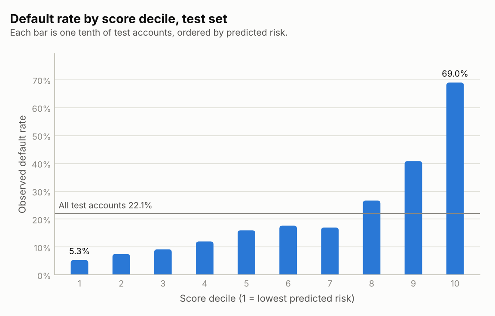
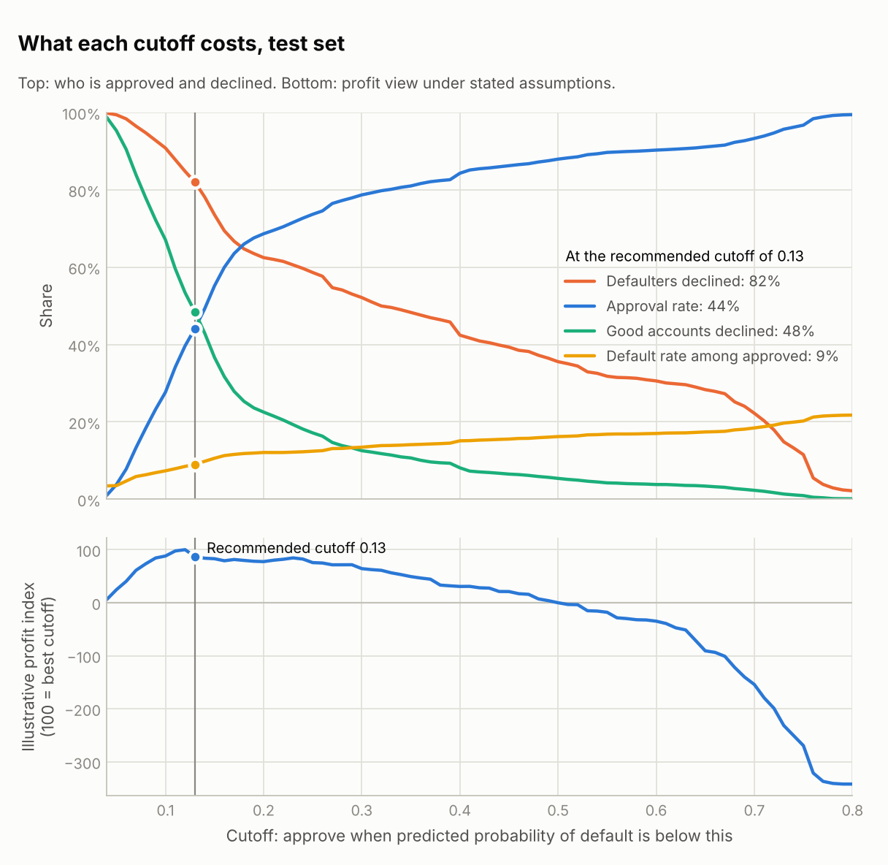

# Credit risk adjudication model

A default model for credit card accounts, plus the parts a lender needs before it can use one: where to put the approval cutoff and what that costs, why an applicant was declined, whether outcomes differ by sex or age, and what to monitor afterwards.

An AI agent then validates it. The second half of this repo is a language-model agent that reviews a submitted model the way an independent validator would: it chooses which tests to run, reads the evidence, and drafts a validation memo. A checker written in ordinary code confirms that every number in the memo is in the evidence it cites. The agent is measured on eight submissions, seven of which have a defect planted on purpose. See [The validation agent](#the-validation-agent).

Live demo: https://ram-balasubramani.vercel.app/demo/credit

Portfolio: https://ram-balasubramani.vercel.app

This is a portfolio project on public data (30,000 Taiwanese cardholders, 2005). It is not a production underwriting model and should not be used to make credit decisions.

Every result below comes from `python -m creditadj all` at seed 42 and is stored in [`reports/metrics.json`](reports/metrics.json). A test fails if the headline figures in this file drift from that file. The one exception is the note on a design I discarded, in the Features section, which quotes runs that are no longer in the repo.

## Results at a glance

Test set, 6,000 accounts the models never saw, default rate 22.1%.

| | AUC | Gini | KS |
|---|---|---|---|
| XGBoost champion (12 features, all monotone) | 0.768 | 0.537 | 0.418 |
| Logistic regression benchmark (same 12 features) | 0.753 | 0.505 | 0.398 |

| Question | Answer |
|---|---|
| How sure is the champion AUC? | 95% bootstrap interval 0.753 to 0.784 (1,000 resamples) |
| Is the champion better than the benchmark? | Yes, by 0.016 AUC (interval 0.010 to 0.021) |
| Is it overfit? | Train AUC 0.787, test 0.768, gap 0.019 |
| What did leaving out sex, age, marital status and education cost? | 0.002 AUC (0.771 with them; interval for the gain -0.000 to 0.005, so not distinguishable from zero) |
| What did the monotonic constraints cost? | 0.011 AUC (0.779 without them) |
| Does risk rise across score deciles? | From 5.3% in the safest decile to 69.0% in the riskiest, with one inversion (decile 7 at 17.0% after decile 6 at 17.7%) |
| Is it calibrated? | Mean predicted 22.05% against 22.12% observed. No recalibration applied. Largest decile gap is 2.9 points |
| Recommended cutoff | Approve below a 13% probability of default. That approves 44.1% of accounts and declines 82.0% of defaulters, at the price of declining 48.4% of good accounts |
| Adverse-impact ratio at that cutoff | 0.954 by sex. 0.786 by age band, which is below the 0.80 screen |
| Do the reason codes agree with XGBoost's own attributions? | Same top reason for 86.4% of declined accounts |

## What is in the repo

```
creditadj/
  data.py       download, checksum, cache
  features.py   the 12 engineered features
  model.py      champion, benchmark, split, calibration rule
  evaluate.py   AUC, Gini, KS, deciles, calibration, bootstrap
  cutoff.py     cutoff table and the illustrative profit view
  reasons.py    reason codes by one-at-a-time replacement
  fairness.py   approval rates by group, adverse-impact ratio
  monitor.py    population stability index
  export.py     web_export/model.json
  pipeline.py   fits everything once and collects the numbers
  plots.py      the four charts
  candidates.py eight model submissions, seven with a planted defect
  validation.py the validation tests and the evidence they return
  validator.py  the validation agent, the memo checker, the scoring
  cli.py        python -m creditadj ...
tests/          the model tests and the validation agent's tests
reports/        metrics.json, four PNG charts, and the 40 raw agent runs with their summary (committed)
web_export/     model.json and validation.json, what the browser demo reads (committed)
MODEL_CARD.md
```

## Data

UCI "Default of Credit Card Clients": 30,000 credit card holders at one bank in Taiwan. For each: credit limit, six months of repayment status, statement balance and payment amount (April to September 2005), four demographic fields, and whether the customer defaulted on the next payment (22.1% did).

The file is not in this repo. `creditadj/data.py` downloads it from UCI into `data/` (git-ignored), checks the SHA-256 of the spreadsheet, then checks the shape: 30,000 rows, the expected 25 columns, no missing values, a 0/1 target.

Source: Yeh, I. (2009). Default of Credit Card Clients [Dataset]. UCI Machine Learning Repository. https://doi.org/10.24432/C55S3H. Licensed CC BY 4.0. Described in Yeh, I-C. and Lien, C-H. (2009), "The comparisons of data mining techniques for the predictive accuracy of probability of default of credit card clients", Expert Systems with Applications 36, 2473-2480.

### Known quirks and what I did about them

**Undocumented repayment status codes.** UCI documents -1 ("pay duly") and 1 to 9 (months of delay). The data also contains -2 and 0, and 0 is the most common value (53.3% of account-months; -2 is 13.6%, -1 is 19.2%, late is 13.9%). Most public analyses read -2 as "no balance to pay", -1 as "paid in full" and 0 as "paid the minimum and carried a balance". I checked that reading against the amounts before using it. By September status code, all 30,000 rows:

| September status | Accounts | Default rate | September bill zero or negative | Median utilisation | September payment covered the August bill |
|---|---|---|---|---|---|
| -2 | 2,759 | 13.2% | 32.7% | 0.5% | 95.3% |
| -1 | 5,686 | 16.8% | 0.1% | 1.7% | 80.1% |
| 0 | 14,737 | 12.8% | 0.0% | 64.1% | 5.3% |
| 1 | 3,688 | 33.9% | 45.8% | 3.3% | 50.1% |
| 2 or more | 3,130 | 69.6% | 0.0% | 72.1% | 6.1% |

The amounts support the reading: code 0 accounts carry large balances and almost never clear them, codes -1 and -2 usually do. So only 1 and above count as late. I do not treat -2, -1, 0 as an ordered scale, because the default rates above are not ordered (13.2%, 16.8%, 12.8%). Months coded -1 are counted in their own feature. I do not use -2 at all: inactivity is measured from the bills instead.

Two things in that table I could not explain and did not try to fix. Accounts that pay in full default more often than accounts that revolve. And 45.8% of accounts coded one month late have no September balance.

**The first status column is called PAY_0 and the next PAY_2.** There is no PAY_1. I rename PAY_0 to PAY_1 so the three monthly blocks line up.

**Negative bills.** 2.2% of statement amounts are negative, which is a credit balance after an overpayment. I floor balances at zero.

**Balances above the limit.** About 7% of accounts have a September bill above their credit limit. I cap utilisation at 1.5.

**Payment timing.** The payment recorded for a month settles the previous month's statement. The repayment ratio matches payments in months 1 to 5 to statements in months 2 to 6.

**Dormant accounts.** 966 accounts have no balance on any of the six statements, and 35.9% of them are flagged as defaulting. I do not know what default means for an account with nothing owed. The model uses the pattern (see `months_zero_balance` below) and I list it as a weakness.

**EDUCATION and MARRIAGE.** EDUCATION has undocumented codes 0, 5 and 6 (345 rows) and MARRIAGE has an undocumented 0 (54 rows). Neither field is a model input. Where they are used (the comparison model and the fairness tables) those rows go into the documented "others" category.

## Features

The champion is trained on these 12 features and nothing else. The web demo scores applicants from the same 12 inputs.

| Feature | Meaning | Constraint |
|---|---|---|
| `credit_limit` | Credit line, NT$ | risk never rises with a higher limit |
| `recent_status` | Months past due on the latest statement, 0 if not late | never falls |
| `worst_status_6m` | Largest months-past-due in six months | never falls |
| `months_late_6m` | Number of months late, 0 to 6 | never falls |
| `months_since_late` | Months since the last late payment, 6 if none in the window | never rises |
| `util_current` | Latest balance / limit, capped at 1.5 | never falls |
| `util_avg_6m` | Average balance over six months / limit | never falls |
| `util_trend` | Utilisation in the latest three months minus the three before | never falls |
| `pay_ratio` | Payments in five months / statements they were due on, 0 to 1 | never rises |
| `last_payment` | Most recent payment, NT$ | never rises |
| `months_paid_full` | Statements paid in full, 0 to 6 | never rises |
| `months_zero_balance` | Statements with no balance, 0 to 6 | never falls |

Eleven of the twelve directions are what a credit officer would expect without seeing data. The twelfth, `months_zero_balance`, is not: its direction comes from the dormant-account pattern in this dataset, and I would not carry it to another portfolio without checking.

My first design left average utilisation unconstrained, because in this data very low utilisation is riskier than moderate utilisation. It scored 0.003 higher in validation AUC (0.779 against 0.776). But the unconstrained feature became the most common top reason for a decline, and nine times in ten the applicant's value was below the typical one, not above. A reason that cannot say which direction is wrong is not a usable reason. So I constrained every feature and moved the inactivity signal into its own feature.

I had already seen the first design's test AUC (0.776) when I made that change, so to be clear about the order of events: the change was decided on the reason-code problem and the validation figures, and it lowered the test AUC to 0.768. Against a fit with no constraints at all (0.779) the cost is 0.011. I kept the decision. Going back because the test number fell would be fitting to the test set.

## Protected attributes

SEX, AGE and MARRIAGE are not model inputs. Sex, marital status and age are prohibited bases under the US Equal Credit Opportunity Act and Regulation B, and prohibited grounds of discrimination under the Canadian Human Rights Act. Regulation B does allow narrow uses of age inside a validated scoring system. I took the simpler position and left it out.

EDUCATION is also out. It is not a prohibited basis in itself, but it can stand in for age, sex or other protected characteristics, and it is not something a lender needs in order to judge repayment behaviour that it can observe directly.

A test (`tests/test_model.py`) checks the fitted model's input list.

Leaving them out cost almost nothing. The same XGBoost configuration with sex, age, marital status and education added reaches a test AUC of 0.771 against 0.768, a gain of 0.002 with a paired bootstrap interval of -0.000 to 0.005.

Leaving an attribute out of the inputs does not make outcomes equal. That is measured separately below.

## Model

**Champion.** XGBoost, 200 trees of depth 3, learning rate 0.05, a monotonic constraint on every feature, no class weighting (so the output stays a probability). Small enough to export as 120 kB of JSON and to read tree by tree.

**Benchmark.** Logistic regression on the same 12 features, with the two currency amounts logged and everything standardised.

**Split.** Stratified 60 / 20 / 20 by the target with a fixed seed: 18,000 train, 6,000 validation, 6,000 test. Validation is used for the calibration decision and for choosing the cutoff. Every reported figure is from the test set.

**No out-of-time test.** The dataset is one snapshot. Every account is observed over the same six months and has its outcome in the same month, and there are no dates to split on. A random split tells you how the model does on other accounts from the same months. It says nothing about how it does a year later, after the mix of customers, the economy or the bank's own policies have moved. Scores usually weaken when they are carried forward in time, so the figures here are likely to be optimistic for a later cohort, and this dataset gives no way to measure by how much.

## Performance



| Decile | Accounts | Defaults | Default rate | Mean predicted |
|---|---|---|---|---|
| 1 | 600 | 32 | 5.3% | 5.2% |
| 2 | 600 | 45 | 7.5% | 7.4% |
| 3 | 600 | 55 | 9.2% | 9.3% |
| 4 | 600 | 72 | 12.0% | 11.2% |
| 5 | 600 | 96 | 16.0% | 13.1% |
| 6 | 600 | 106 | 17.7% | 15.0% |
| 7 | 600 | 102 | 17.0% | 17.9% |
| 8 | 600 | 160 | 26.7% | 26.3% |
| 9 | 600 | 245 | 40.8% | 43.2% |
| 10 | 600 | 414 | 69.0% | 71.9% |

The ordering holds except between deciles 6 and 7 (106 defaults against 102), which is within sampling noise for bands of 600.

**Calibration.** I fit a Platt scaling on the validation set as a check: slope 0.975, intercept -0.011. My rule was to apply it only if either was more than 0.10 away from "no change", so the raw scores are used as they are. On the test set, applying it anyway would have moved the Brier score from 0.1372 to 0.1371.

The weak spot is the middle. Deciles 5 and 6 are under-predicted by 2.9 and 2.7 points, and that is exactly where the cutoff sits. Accounts scored between 12% and 14% defaulted at 16%. A lender should know that before relying on the break-even arithmetic below.

Other charts: [ROC](reports/roc.png), [calibration](reports/calibration.png).

## The cutoff decision

The rule is: approve when the predicted probability of default is below the cutoff. Moving the cutoff trades approvals against losses. The table and chart show what each choice costs on the test set. Exposure is the most recent statement balance.



| Cutoff | Approved | Default rate among approved | Defaulters declined | Defaulted balance declined | Good accounts declined | Illustrative profit index |
|---|---|---|---|---|---|---|
| 0.08 | 18.4% | 6.3% | 94.7% | 93.8% | 77.9% | 73 |
| 0.10 | 27.7% | 7.3% | 90.8% | 86.9% | 67.1% | 88 |
| 0.12 | 39.7% | 8.5% | 84.8% | 75.9% | 53.4% | 100 |
| **0.13** | **44.1%** | **9.0%** | **82.0%** | **70.4%** | **48.4%** | **87** |
| 0.14 | 49.3% | 9.8% | 78.1% | 67.9% | 42.9% | 84 |
| 0.16 | 60.0% | 11.3% | 69.4% | 63.6% | 31.7% | 79 |
| 0.20 | 68.6% | 12.1% | 62.5% | 60.5% | 22.5% | 77 |
| 0.30 | 78.7% | 13.5% | 52.1% | 56.1% | 12.6% | 64 |

### The profit view is illustrative

The last column needs two numbers that are not in the data. They are my assumptions, and both can be changed on the command line (`--lgd`, `--margin`).

- **Loss given default: 75% of the balance** on an approved account that defaults.
- **Annual margin: 12% of the balance** on an approved account that does not default.

Profit is margin on the balances of approved good accounts minus loss on the balances of approved defaulters, indexed so the best cutoff on the grid is 100. Only the ratio of the two assumptions matters for where the peak falls: with these, one default wipes out the margin on about six good accounts of the same size, and the break-even probability of default is 0.12 / (0.12 + 0.75) = 13.8%.

### Recommended cutoff: 0.13

I chose the cutoff that maximises the profit view on the validation set, then read its consequences off the test set, so the test figures are not flattered by the choice.

- On validation it approves 44.1% and declines 83.6% of defaulters. On test it approves 44.1% and declines 82.0%. (The two approval rates are both 2,648 of 6,000. That is a coincidence, not a bug: the counts differ at 0.12 and at 0.14.)
- It agrees with the break-even figure of 13.8%, which is some evidence that the probabilities mean what they say.
- On the test set the best cutoff would have been 0.12, and 0.13 reaches 87% of that profit. I report that gap as it is. The profit curve is lumpy because a few large balances move it, and 6,000 accounts is not many for a balance-weighted measure.

What it costs is plain in the table: nearly half of the customers who would have paid are declined. This population is unusually risky (22% default in one month, sampled while Taiwanese card issuers were in a debt crisis, according to the source paper), and with a 75% loss the arithmetic is unforgiving. A lender with a volume target, a different cost of funds or a collections operation that recovers more would pick a different row, which is the point of showing the whole table.

How the choice moves with the assumptions (cutoff picked on validation, outcomes on test):

| Loss given default | Margin | Break-even PD | Best cutoff | Approved | Defaulters declined | Good accounts declined |
|---|---|---|---|---|---|---|
| 75% | 4% | 5.1% | 0.04 | 1.0% | 99.8% | 98.8% |
| 75% | 8% | 9.6% | 0.12 | 39.7% | 84.8% | 53.4% |
| 75% | 12% | 13.8% | 0.13 | 44.1% | 82.0% | 48.4% |
| 75% | 16% | 17.6% | 0.13 | 44.1% | 82.0% | 48.4% |
| 75% | 20% | 21.1% | 0.19 | 67.6% | 63.5% | 23.6% |
| 50% | 12% | 19.4% | 0.19 | 67.6% | 63.5% | 23.6% |

At a 4% margin the rule approves 1% of this book. That says more about the population than about the model. Between 8% and 16% the answer stays at 0.12 to 0.13. The steps are uneven for the same reason the curve is lumpy.

What the profit view leaves out: recoveries over time, the fact that a missed payment is not yet a write-off, interchange and fee income, funding cost, the value of keeping a customer, and anything that happens after the first month.

## Fair-lending check

The model does not see sex, age or marital status. This section checks what happens to those groups anyway, at the recommended cutoff, on the test set. The adverse-impact ratio is the lowest group approval rate divided by the highest. A ratio under 0.80 is the "four-fifths" screen. That convention comes from US employment guidelines and is not a legal test for lending, but it is a common first look.

**By sex.** Adverse-impact ratio 0.954.

| Group | Accounts | Approved | Observed default rate | Default rate among approved | Approved, among those who did not default |
|---|---|---|---|---|---|
| Male | 2,402 | 42.9% | 23.4% | 8.7% | 51.1% |
| Female | 3,598 | 45.0% | 21.3% | 9.2% | 51.9% |

**By age band.** Adverse-impact ratio 0.786, below the screen.

| Group | Accounts | Approved | Observed default rate | Default rate among approved | Approved, among those who did not default |
|---|---|---|---|---|---|
| 21-29 | 1,912 | 38.9% | 22.3% | 8.3% | 45.9% |
| 30-39 | 2,198 | 49.5% | 20.6% | 8.7% | 56.8% |
| 40-49 | 1,341 | 44.7% | 23.3% | 10.2% | 52.4% |
| 50+ | 549 | 39.7% | 24.6% | 9.6% | 47.6% |

The age result needs an explanation, so I looked for one. Customers aged 21 to 29 are approved less often than those aged 30 to 39, and the gap is still there among customers who did not default (45.9% against 56.8%), so it is not just a difference in risk. To find the route, I re-scored the test set twelve times, each time giving everyone the same value for one feature. Equalising `credit_limit` lifts the ratio from 0.786 to 0.936. No other feature gets it past 0.873. The median limit is NT$90,000 for the 21-29 band against NT$180,000 for 30-39. So age reaches the decision mainly through the credit limit, which the bank itself set.

I have not changed the model in response. On a real portfolio this finding would go to compliance with two options costed: drop or cap the contribution of credit limit, or keep it and document the business justification. The comparison I would want is what each alternative does to both the ratio and the default rate among approved accounts.

By marital status the ratio is 0.704, but that is driven by the "Other" category, which has 75 accounts in the test set. Married and single customers are approved at 45.5% and 43.3%.

Limits of this check: it covers three attributes, one cutoff and one test split. There is no race, ethnicity or national-origin field in the data, and no intersectional analysis.

## Reason codes

When an applicant is declined, a lender has to say why. The method here was chosen so that a browser can reproduce it exactly with no SHAP library.

1. Score the applicant.
2. For each feature in turn, replace that one value with a reference value and score again. The reference is the median of approved, non-defaulting accounts in training.
3. The drop in predicted probability is that feature's effect.
4. Report the fixed sentence for the four largest drops. A drop under 0.001 is not reported.

Because every feature is constrained, a positive drop can only come from a value on the risky side of the reference. So each sentence can state a direction ("too recent", "too high") and be right by construction. A test checks this on declined accounts.

A real declined account (`python -m creditadj explain --row 0`):

```
Test-set row 0
Predicted probability of default: 0.3132
Cutoff: 0.13  ->  DECLINE
Observed outcome in the data: defaulted

Reasons for the decline, largest effect first:
  1. Last late payment was too recent
     months_since_late = 1; typical approved account = 6; replacing it lowers the probability by 0.0842
  2. Worst delinquency in the last six months was too severe
     worst_status_6m = 2; typical approved account = 0; replacing it lowers the probability by 0.0680
  3. Most recent payment amount was low
     last_payment = 0; typical approved account = 4800; replacing it lowers the probability by 0.0534
  4. Existing credit limit is low
     credit_limit = 120000; typical approved account = 210000; replacing it lowers the probability by 0.0251
```

### Limits of the method

- It is a one-at-a-time perturbation, not a Shapley decomposition. The drops do not add up to the gap between the applicant and the reference, and interactions between features are credited to whichever feature is being replaced.
- Replacing one value can describe an account that could not exist, such as no late months together with a worst status of 2. The delinquency features overlap, so two or three of the four reasons are often versions of the same fact, as in the example above.
- The answer depends on the reference point. A different reference gives different reasons.
- Of the 3,352 declined test accounts, all get at least one reason and 896 get fewer than four.
- The most common first reason is a low most-recent payment (28.0% of declines), followed by a recent late payment (18.4%). "Your last payment was small" is a true statement about the input and a weak thing to tell a customer. It is partly the dormant-account pattern showing up through another feature.

### Agreement with XGBoost's own attributions

On a seeded sample of 500 declined test accounts I compared the top reasons with XGBoost's `pred_contribs` (TreeSHAP), ranking its positive contributions.

| Measure | Result |
|---|---|
| Same top reason | 86.4% |
| My top reason is in its top four | 100.0% |
| Average overlap of the two top-four lists | 88.9% |

The two methods answer slightly different questions (TreeSHAP explains the gap to the average score, replacement explains the gap to a typical approved account), so I did not expect full agreement. One in seven declined applicants would get a different first reason under TreeSHAP.

## Monitoring

`creditadj/monitor.py` computes the population stability index for the score and every feature, with the usual thresholds: below 0.10 stable, 0.10 to 0.25 investigate, 0.25 and above review.

Train against test, where nothing should have moved, gives a PSI of 0.003 or less for every variable. To show what a shift looks like, I compared the test set with a stressed copy of itself: balances up 30%, repayment ratio down 20%, and one in ten up-to-date accounts missing its latest payment.

| Variable | PSI, test against shifted copy | Reading |
|---|---|---|
| score | 0.040 | stable |
| `util_current` | 0.321 | review |
| `pay_ratio` | 0.238 | investigate |
| `util_avg_6m` | 0.198 | investigate |
| `worst_status_6m` | 0.062 | stable |
| `recent_status` | 0.049 | stable |

The score barely moves while two inputs are in the red. That is the reason to track inputs and score separately: by the time the score PSI fires, the population has already changed a great deal.

Monitoring plan, if this were live:

- **Monthly.** PSI for the score and each feature against the development sample. Approval rate, override rate and the mix of reason codes. Data checks on the status fields, including any code not seen in development. Early delinquency on recent approvals.
- **Quarterly.** AUC, Gini and KS on accounts whose outcome is now known. Default rate by score decile against predicted, with attention to the deciles around the cutoff. Adverse-impact ratios. The cutoff table re-run with actual margin and loss figures.
- **Annually.** Full revalidation: refit a challenger on recent data, re-test each monotonic constraint, re-check the reason-code reference values, review the assumptions and update the model card.

Triggers I would propose for an early review: score PSI of 0.25 or more, a fall in AUC of more than 0.03 from development, or an adverse-impact ratio below 0.80 for two quarters running.

## The validation agent

Before a bank uses a model, someone independent has to try to break it. US supervisory guidance has asked for three things from that review since 2011, and still does in SR 26-2, which replaced SR 11-7 in April 2026: conceptual soundness, outcomes analysis and ongoing monitoring. Much of the work is running a known set of tests and writing up what they show, which is the kind of work a language model can draft. The risk is a fluent memo with a wrong number in it.

So the design splits the work three ways:

- **Tests are code.** `creditadj/validation.py` has eleven tests (performance, benchmark, calibration, rank ordering, inputs, feature detail, data integrity, stability, fairness, sensitivity, cutoff). Each returns evidence items: an id and one sentence with the measured numbers in it. A test reports what was measured and the usual convention for reading it. It never says whether the result is acceptable.
- **The agent decides and writes.** `creditadj/validator.py` gives a language model the developer's summary and one tool, `run_test`. It chooses the tests, follows up what looks odd (for example, looking up the data dictionary entry of an input that dominates the model), and ends by calling `submit_memo` with a decision and findings. It has at most 14 test runs.
- **A checker verifies the memo.** `check_memo` asks no model anything. Every finding must cite evidence the agent was actually shown. Every number in a finding must appear in the evidence that finding cites. The decision must follow from the severities.

The memo is a draft for a human validator to sign. Nothing here approves a model.

### The number policy

A number in the memo is supported if it equals a number in the cited evidence, or that number rounded to fewer decimals, ties to even. Signs and percent signs are ignored. Nothing else is accepted: 0.786 does not support "79%", and adding two figures together is not allowed. Whole numbers from 0 to 10 are not checked, because they are usually counts in the memo's own prose. Names of regulations such as SR 26-2 are not read as numbers.

When a number fails, the checker says which way. `number_not_cited` means the figure is somewhere in what the agent was shown but not in what the finding cites, which is usually a citation slip. `unsupported_number` means it is nowhere in the evidence: invented, or worked out by the agent.

The rounding policy has its own tests (`tests/test_validator.py`), because a checker that is too strict or too loose changes every result below.

### Eight submissions, seven planted defects

`creditadj/candidates.py` builds eight models. All are really fitted on the UCI data, and every number the tests report about them is computed from that fit.

| Submission | What was planted | What reveals it |
|---|---|---|
| A | Nothing. This is the champion | |
| B | Target leakage: an input written in the month the outcome is measured | The input's gain share and its data dictionary entry |
| C | Overfitting: 800 trees of depth 9 | Training AUC 1.000 against 0.735 on test |
| D | Miscalibration: defaults up-weighted and never corrected | Mean predicted 45.3% against 22.1% observed |
| E | Prohibited inputs: age, sex and marital status used directly | The input list |
| F | Population drift: a sound model, a book that has moved | Stability index of 3.360 on one input |
| G | Underperforms: three inputs, twenty stumps | 0.117 AUC below a plain logistic regression |
| H | Contaminated test set: half the test rows were used in training | 3,000 of 6,000 test accounts overlap |

Each submission carries the developer's own summary, which never mentions the defect, and a hidden answer key. The agent sees the summary and the tests. It never sees the key.

### Results: 40 live runs

I ran each submission five times through the live agent on 22 November 2026 and scored every memo against the answer key. A defect counts as caught only if a high or medium finding cites the evidence that reveals it. Rejecting for a different reason does not count. All 40 raw memos are in [`reports/agent_runs.json`](reports/agent_runs.json), and `python -m creditadj score-runs` reproduces the table from them.

| | Result |
|---|---|
| Planted defect caught | 35 of 35 runs |
| High-severity finding on the sound model | 0 in 5 runs |
| Defensible decision (not "approve" on a defective model, not "reject" on the sound one) | 40 of 40 |
| Same decision as the fixed-threshold baseline | 26 of 40 |
| Memo passed the checker | 16 of 40 |
| Average run | 7.8 seconds, about 15,400 tokens, 3.1 rounds |

| Submission | Caught | Agent decided | Fixed rules decide | Checker passed |
|---|---|---|---|---|
| A, nothing planted | no false alarm | approve with conditions 5 | approve with conditions | 2 of 5 |
| B, leakage | 5 of 5 | reject 5 | reject | 2 of 5 |
| C, overfitting | 5 of 5 | reject 5 | reject | 1 of 5 |
| D, miscalibration | 5 of 5 | approve with conditions 4, reject 1 | reject | 1 of 5 |
| E, prohibited inputs | 5 of 5 | reject 5 | reject | 2 of 5 |
| F, drift | 5 of 5 | reject 5 | approve with conditions | 1 of 5 |
| G, underperforms | 5 of 5 | reject 5 | reject | 5 of 5 |
| H, contaminated test set | 5 of 5 | approve with conditions 5 | reject | 2 of 5 |

### What the results say

The agent found every planted defect and raised no false alarm on the sound model. Its memos are less reliable than its findings, and the checker is what shows that:

- **19 memos quoted a real figure but cited the wrong evidence for it** (27 instances). A typical case: a finding quotes the 0.80 screen without citing the note that states it.
- **7 memos stated a figure the agent had worked out itself.** I read all seven. Each one adds two or three gain shares together ("about 65% of total gain"). The sums look right, but the instructions say not to do arithmetic, and a checker cannot confirm a number that is in no evidence.
- **4 memos contradicted themselves.** All four are on submission D: a high-severity finding on calibration, then a recommendation to approve with conditions. The rule in the prompt is that any high finding means reject.
- **Severity is where it disagrees with me.** On the contaminated test set it noticed the overlap in all five runs and rated it medium in all five. I would reject: a test set that shares half its rows with training is not a test set. On drift it was stricter than the fixed rules.

### How to read these numbers

- **The defects are loud.** I planted them and wrote the tests, so every defect is one the evidence can reveal. A catch rate of 35 of 35 says this set is too easy to rank one model against another. Real validation turns up problems nobody thought to test for.
- **Five runs per submission is a small sample.** The same agent on the same input does not always give the same memo. Treat every rate here as rough.
- **The baseline is not independent.** The fixed-threshold baseline (`rules_memo`) was written by the same person who planted the defects, so it catches all of them. It is there to show what the evidence supports, not as a competitor.
- **One measurement run was thrown away.** In the first run the agent returned citations as "[PERF-GAP] sentence" and my scorer only accepted the bare id, so correct findings were scored as misses. That was a bug in the harness. I changed it to read the id off the front (`clean_evidence_id`, with a test) and ran all 40 again. The numbers above are the second run, complete.
- **The answer key was widened once.** For submission E the agent cited the input list and the fairness test's line on demographic inputs. Both reveal the defect, and my first key did not list them. The change is marked in `candidates.py`.
- **The checker checks numbers and citations, not judgement.** A memo can pass it and still be wrong about what matters.
- **The live demo and the Python loop are two implementations of one design.** The measured runs went through the live demo's loop, which calls a hosted model. The Python loop in `validator.py` speaks to any chat-completions endpoint with tool calling and is tested here against a scripted stand-in (`tests/test_validator.py`). The checker exists in both and the two were compared on 328 clean and tampered memos: 965 problems each, no differences.

### Run it

```bash
# the fixed-threshold baseline on every submission, with the answer key
python -m creditadj validate --reveal

# the agent on one submission (any chat-completions endpoint with tool calling)
export VALIDATOR_LLM_API_KEY=...
export VALIDATOR_LLM_BASE_URL=https://your-endpoint/v1
export VALIDATOR_LLM_MODEL=your-model
python -m creditadj validate --agent --submission B --reveal

# re-score the published runs
python -m creditadj score-runs
```

## Web export

`python -m creditadj export-web` writes [`web_export/model.json`](web_export/model.json) (120.5 kB): the trees, feature definitions, cutoff grid, metrics, fairness tables, reason texts and five preset applicants from the test set with the probability the Python model gives each.

To score from the file:

1. Round each input to float32 (`Math.fround` in JavaScript). XGBoost stores inputs and thresholds as float32, and skipping this step sends a value that equals a threshold down the wrong branch.
2. In each tree start at node 0. At a split go to `y` if `x < t`, to `m` if x is missing, otherwise to `n`. Stop at a leaf `{"v": ...}`.
3. Margin = `base_score_logit` + sum of leaf values. Probability = 1 / (1 + exp(-margin)). `calibration` is `null` in this export. If it were not, the margin would become `a * margin + b` first.

`tests/test_web_export.py` contains a pure-Python walker that does exactly this. It matches XGBoost's own probabilities to within 1e-6 on 200 test rows, and it reproduces the stated probability of each preset in the committed file.

## Limitations

- **Old, foreign, one bank.** Taiwan, 2005, one issuer, during a card-debt crisis. Nothing here transfers to another market without redevelopment.
- **No out-of-time test.** See above. All performance figures are for the same months the model was trained on.
- **These are existing cardholders, not applicants.** The inputs are six months of behaviour on the card, which an applicant does not have. A real adjudication model would use bureau and application data and would have to deal with the fact that outcomes are only seen for people who were approved. This project uses behaviour data as a stand-in to show the decision framework.
- **The default flag is thin.** It is "default payment next month". The source does not say how many days past due that means, and it is a one-month outcome window. Lenders usually model 90 days past due over 12 months or more.
- **Dormant accounts.** The model penalises accounts with no balance because the data says they default more. That may be an artefact of how the flag was built.
- **Calibration is weakest near the cutoff.** Deciles 5 and 6 are under-predicted by about 3 points.
- **The age result fails the four-fifths screen** and I have reported it, not fixed it.
- **The economics are assumptions.** The recommended cutoff moves if they move.
- **No hyperparameter search.** Tree count, depth and learning rate were fixed in advance to keep the model small. I made feature and constraint choices on the validation set, so the validation AUC is slightly optimistic. I looked at the test set for two designs (see Features), and the second was not chosen on its test result.
- **One seed.** The bootstrap interval covers sampling of test accounts, not variation from a different split.

## How to run

Python 3.10 or later. Results here were produced on Python 3.13 with the versions noted in `requirements.txt`.

```bash
pip install -r requirements.txt

python -m creditadj all            # everything: reports/metrics.json, 4 charts, web_export/model.json
python -m creditadj train          # fit and print the fit summary
python -m creditadj evaluate       # test metrics, deciles, calibration, comparison models
python -m creditadj cutoff         # cutoff table and sensitivity
python -m creditadj cutoff --lgd 0.6 --margin 0.15    # with your own assumptions
python -m creditadj explain --row 0                   # decision and reasons for one test-set row
python -m creditadj fairness       # approval by sex, age band, marital status
python -m creditadj monitor        # PSI tables
python -m creditadj export-web     # web_export/model.json

python -m pytest                   # 50 tests
```

The first command downloads the dataset (5.5 MB) into `data/`. Fitting takes about a second, so every command refits from the cached data with the fixed seed. There is no saved model to go stale.

## About

Built by Ramesh Krishnan Balasubramani. I have spent more than five years building and validating credit-risk and financial-crime models, including validation work under SR 11-7. The repo is laid out the way I would want to receive a model for validation: what it may see, what it costs, where it is weak, and how to tell when it stops working. More detail is in [MODEL_CARD.md](MODEL_CARD.md).

Code is MIT licensed. The dataset is CC BY 4.0 and belongs to its authors.
